<!-- title: How to use srijitmath.com to build your excellence in mathematics?
subtitle: Every feature, picture by picture, for beginners and advanced learners. Read it slowly. Then pick up a pen.
published: 2026-11-13T13:08:45.108Z
updated: 2026-11-13T13:08:45.108Z -->

# How to use srijitmath.com to build your excellence in mathematics?

Before you read anything else, do one thing for me. Sit back. Take one slow breath in, and let it go.

Notice where you are right now. Maybe you are on your phone, between two notifications. Maybe it is late, and your mind is already tired from a hundred small things it did today. That is okay. Just notice it.

Now remember the last time you solved a mathematics problem completely on your own. Pen in your hand. Paper in front of you. Nothing else open. Remember the moment it clicked? Something quiet rises inside you at that moment. Some people call it confidence. I call it shakti (power) - your own power. No video and no reel can hand it to you. You build it yourself, one problem at a time, with your own hands.

I built srijitmath.com for exactly that. In this post, I will show you every part of it, picture by picture. The pictures show a sample learner, Ananya, so you can see what it looks like once you have started, and the blue numbers in each picture match the points under it. Read it slowly. By the time you reach the end, you will already know which problem you are going to solve first.

## The goal

Mathematics is learnt the way swimming is learnt: in the water. You can watch a hundred swimming videos and still sink. So the whole website is one loop, and the loop is simple on purpose.

1. You solve a problem by hand, on paper, with everything else switched off.
2. You take a photo of your pages, and the site types out exactly what you wrote.
3. I grade it out of 10 that night, and write feedback only for you.
4. You discuss it with everyone who solved the same problem.
5. The site gives you your next problem: a simpler one if you were stuck, a step up if you did well.

Every time you go around this loop, something in you gets a little stronger. You won't feel it on the first day. Somewhere in the second or third week, you will notice that problems which looked impossible start looking like puzzles. A little later, they start looking like friends. Keep going around the loop, and let it change you.

## Start here

Everything begins with one click.

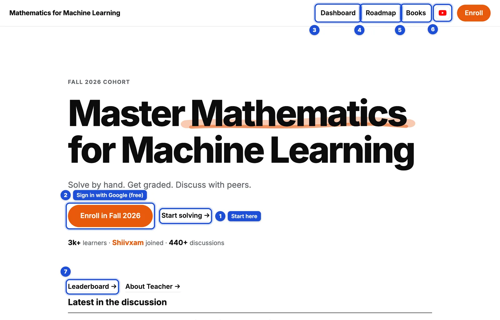

1. **Start solving** takes you to the problems.
2. **Enroll in Fall 2026** signs you in with Google. It is free. Once you are signed in, you can post solutions, read the discussion and get graded.
3. **Dashboard** is your own page: your level, your Math Karma and every problem you have solved.
4. **Roadmap** shows how the topics lead into each other.
5. **Books** has the books and free courses I recommend.
6. **Videos** is my YouTube channel, where I solve these problems on the board.
7. **Leaderboard** shows who is solving and getting claps, this week and of all time.

## Beginner or advanced

Your first decision is easier than it looks.

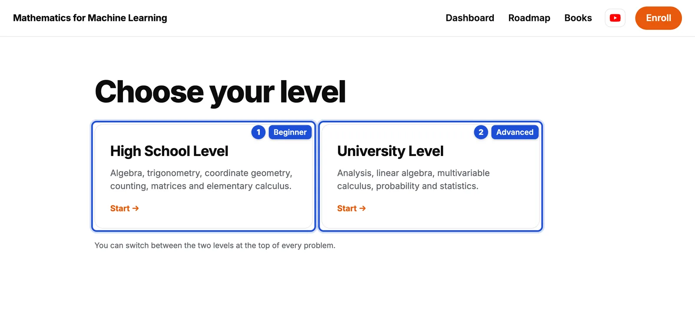

1. **High School Level** is for beginners: algebra, trigonometry, coordinate geometry, counting, matrices, and elementary calculus. Start here if you are in school, preparing for competitive entrance exams, or coming back to mathematics after a long break.
2. **University Level** is for advanced learners: analysis, linear algebra, multivariable calculus, probability and statistics. Start here if you are heading into machine learning, data science, or quant finance, or preparing for a master's entrance.

Not sure? Pick High School. A mind that is not afraid learns faster, and the first problems will feel within reach. If Lesson 1 feels easy, switch. You can switch at the top of every problem, any time, and nothing you have done is lost.

## A problem page

This is where you will spend most of your time. Look at it once, calmly, and let your eyes find each number.

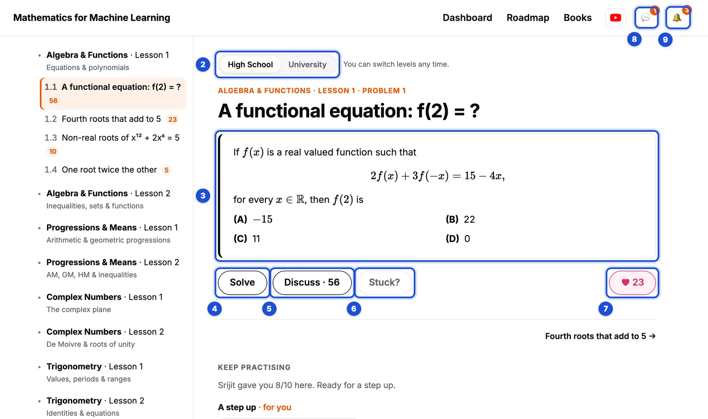

1. **Every problem, lesson by lesson.** Four problems in each lesson. The small orange number next to a problem tells you how many posts its discussion has.
2. **Switch levels** between High School and University.
3. **The problem.** Read it slowly, twice. Then close your laptop and take out a pen.
4. **Solve** is where you upload your solution.
5. **Discuss** has everyone's solutions, my own solution, and questions.
6. **Stuck?** is for when you have really tried and can't move. More on this below.
7. **♥** is for a problem you enjoyed.
8. **💬** is your private conversation with me.
9. **🔔** brings you my grades and feedback, claps and replies.

## Solve: from your notebook to the website

This part changed recently, and I am very happy about it. Earlier, you had to turn your handwritten pages into text somewhere else and paste it back here. You don't need to do that any more. The website reads your handwriting itself.

So, write your solution on paper, by hand. Feel the pen move. When you are done, press **Solve**.

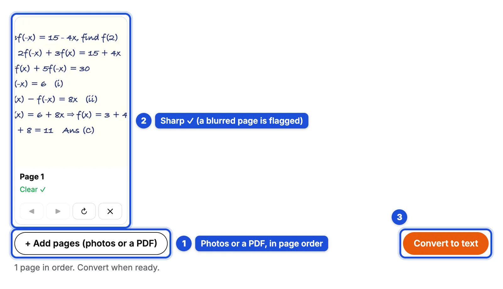

1. **+ Add pages.** Take photos of your pages with your phone, or upload a PDF. Add them in order, page 1 first.
2. **Every page is checked.** A sharp page says "Clear ✓". A blurred, dark or cut-off page is flagged, so you can take just that one photo again with ↻. ◀ ▶ change the order, and ✕ removes a page.
3. **Convert to text.** The site reads your pages and types them out.

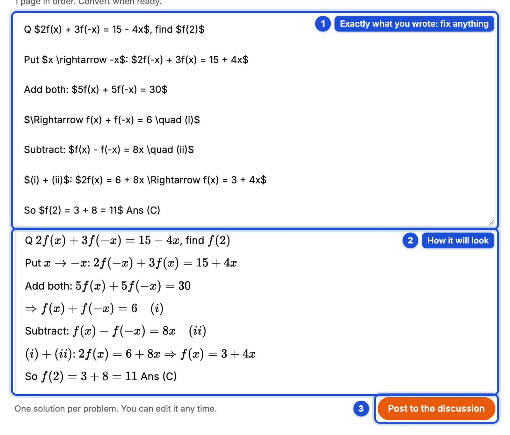

1. **Exactly what you wrote.** It copies your words and your mathematics line by line. It does not add steps, it does not fix your mistakes, and it does not solve anything for you. If it read a word wrongly, fix it here. Mathematics is written between dollar signs, and you see it typeset just below as you type.
2. **How it will look**, with the mathematics typeset, as you edit.
3. **Post to the discussion.** One solution per problem, and you can come back and edit it.

You can convert up to 20 pages a day. Your photos are only used to read your writing. They are not stored.

Now, pause here for a second, because this is the one rule of this website.

Think of your brain as a muscle. Every time you let something or someone else solve a problem for you, it is like asking them to lift your weights. You feel productive, and you grow weaker. It happened to me. For two years, my productivity went up and my thinking went down, and I didn't even notice it happening. So, solve it yourself, by hand. Every line. If a solution doesn't look like your own work, I will ask you to explain each step. The converter saves you typing. The thinking stays yours, and so does the power that comes with it.

## Get graded, and discuss

Something changes when another person reads your solution. You start writing more clearly. Then you start thinking more clearly. I read and grade the solutions every night, Eastern time. Open **Discuss** on a problem.

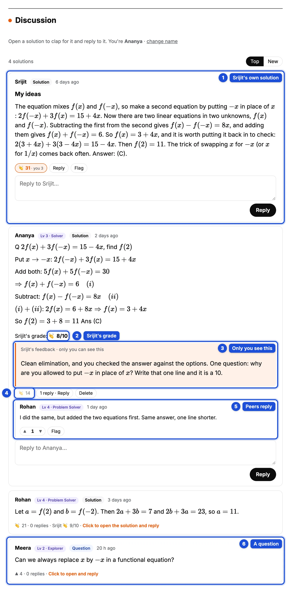

1. **My own solution**, with my ideas. Read it after you have tried, not before. You will understand it ten times better.
2. **My grade**, out of 10. Everyone can see it.
3. **My feedback**, written for you. Only you can see it. Read it slowly, the way you read a letter. Often it is one question that takes you from an 8 to a 10. Answer it by improving your solution.
4. **Claps 👏.** When someone's solution teaches you something, clap for it, up to 50 times.
5. **Replies.** Ask about a step, show a shorter way, point out a gap. This is where most of the learning happens.
6. **Questions.** If something in a problem confuses you, ask it. Others can upvote it and answer.

Please discuss. A solution nobody talks about gives you only half of what it can. Every time you post yours, read two others, and reply to one.

## Keep practising: you never have to wonder what to do next

Under every problem you have solved, the site picks your next problem, based on my grade.

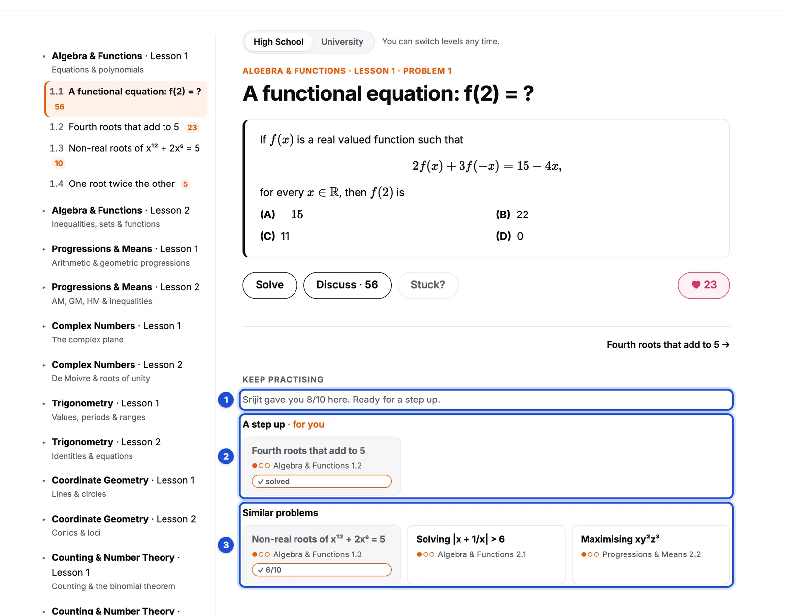

1. **What my grade means for you.** 7 to 10, and you are ready for a step up. 4 to 6, and a similar problem will make it stick. 0 to 3, and a simpler problem comes first, then you come back.
2. **A step up**: a harder problem that builds on this one.
3. **Similar problems**: the same idea in a different form. A ✓ marks the ones you have solved, with my grade.

And when you are stuck before you have even started:

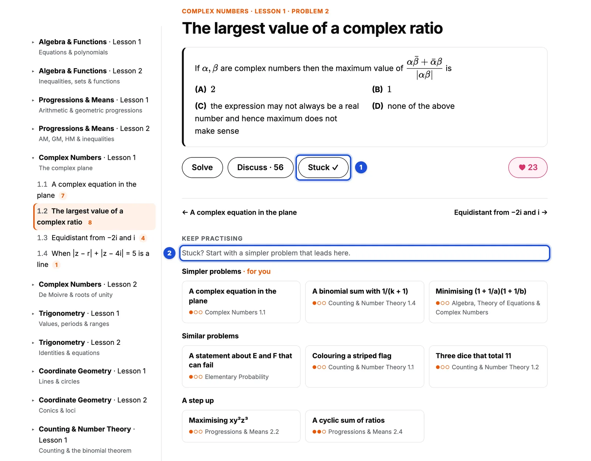

1. Press **Stuck?** on the problem.
2. The site shows you **simpler problems that lead to it**. Solve one, then come back.

Being stuck is not failing. It is the moment your brain is building a new road. Stay with the problem a little longer than feels comfortable. Walk around. Come back to it. And when you have truly tried, press **Stuck?** without any guilt.

## Notifications and messages

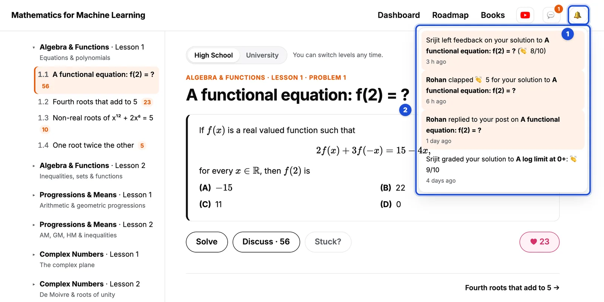

1. **The bell 🔔** shows a number when something new happens.
2. Open it to see **my grades and feedback, claps, and replies** to your posts. Click one to go straight there.

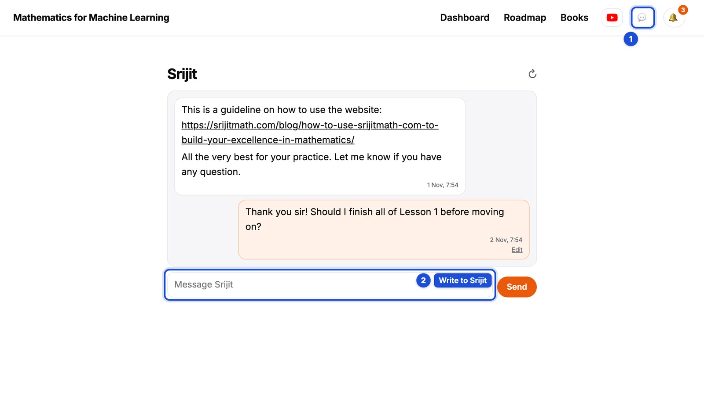

1. **💬** opens your private conversation with me.
2. **Write to me** here: a doubt, a request, anything. I read every message and reply every night.

## Your dashboard

Every problem you solve stays here. On a bad day, open this page and look at how far you have come.

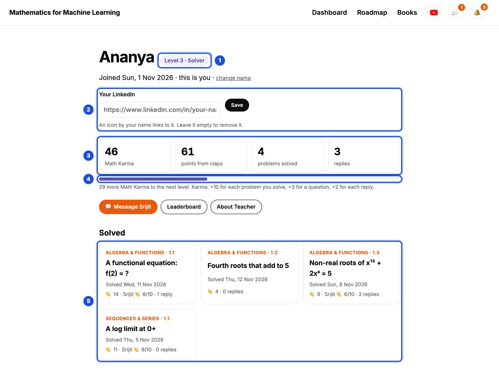

1. **Your level** goes from Newcomer, Explorer, Solver, Problem Solver and Prover up to Theorist and Mathematician.
2. **Your LinkedIn.** Add it, and a small LinkedIn icon appears next to your name everywhere on the site.
3. **Your numbers.** Math Karma grows when you take part: +10 for each problem you solve, +3 for a question, +2 for each reply. Points come from the claps others give your solutions, and my grades count as claps too.
4. **The bar** shows how close you are to the next level.
5. **Every problem you have solved**, with your claps, my grade and the replies. Click one to go back to it.

## The leaderboard

Some of you will come for the leaderboard. That's okay. Stay for the mathematics.

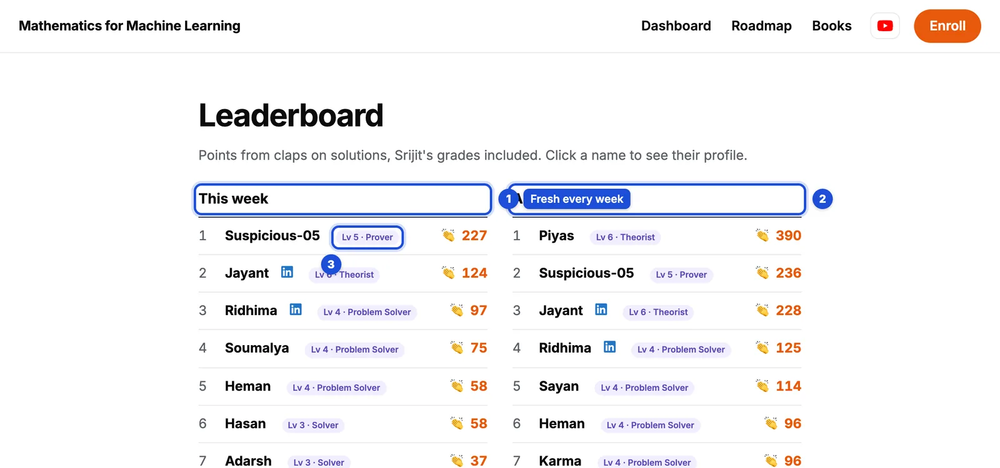

1. **This week** starts fresh every week, so someone who joined yesterday can be on top by Sunday.
2. **All time** counts everything since you joined.
3. **Levels** sit next to every name. Click a name to see their solutions. It is a good way to find people to study with.

## Roadmap and books

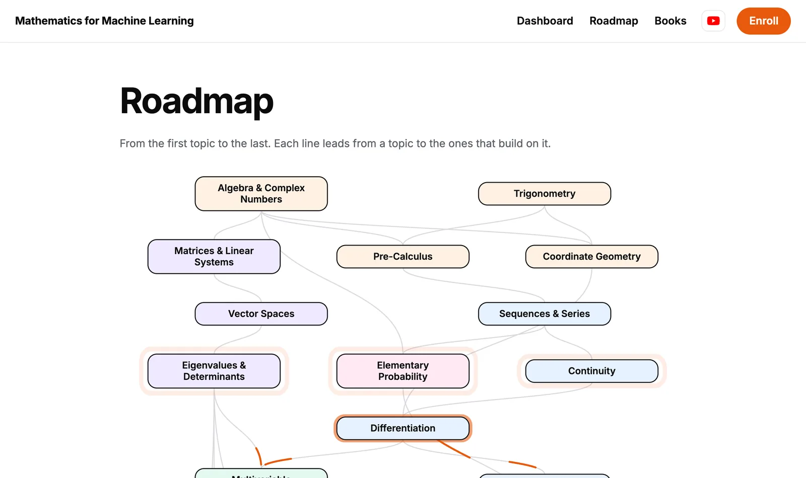

The **Roadmap** shows every topic, from high school algebra to statistical inference, and how each one leads to the ones that build on it. Use it to see where a problem fits and what comes after it.

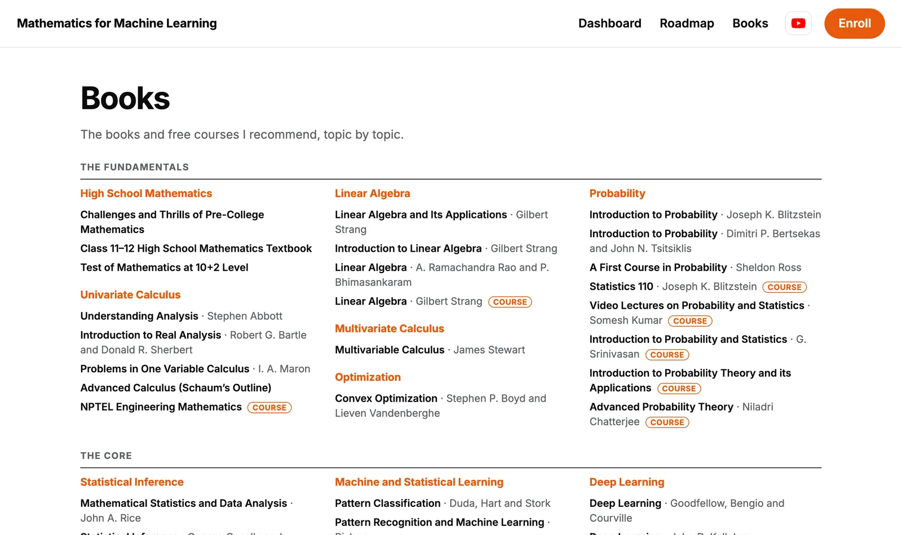

**Books** lists the books and free courses I recommend, topic by topic. Pick one book per topic and finish it, slowly.

## Before you go

Take one more slow breath, and picture yourself six months from now.

You sit down at your table. Your phone is in another room. You read a problem once, and instead of fear, you feel curious. Your pen starts moving before you have even decided to begin. Your dashboard is full of solved problems, and a few of them have my 10/10 next to them. People in the discussion know your name, because your solutions help them think.

That person is not someone else. That is you, a little later. Here is how you get there.

If you are a beginner:

* Start at High School, Lesson 1, Problem 1, and go in order.
* One problem a day is enough. Give it at least 30 minutes on paper before you open the discussion.
* When you are stuck after a real try, press **Stuck?** and solve a simpler problem first.
* When my feedback asks you a question, answer it by editing your solution.

If you are advanced:

* Start at University. Use the Roadmap to choose, but finish every lesson you start.
* Write complete proofs, not just answers. I grade the reasoning, not the final number.
* After you post, find the shortest correct solution in the discussion and understand why it works.
* Answer other people's questions. Explaining is the fastest way to find what you don't understand yet.

And for everyone: paper first, website second. Read my feedback. Discuss. Come back tomorrow, at the same time, and the habit will start carrying you.

You have read this far, and that tells me something about you. So don't wait for a perfect day. It doesn't come. Close this page, take out a pen, and [start solving at srijitmath.com](https://srijitmath.com/start/).

Disappear for one hour a day, and achieve excellence in mathematics. I'll see you in the discussion. Feel free to message me when you have any questions.

