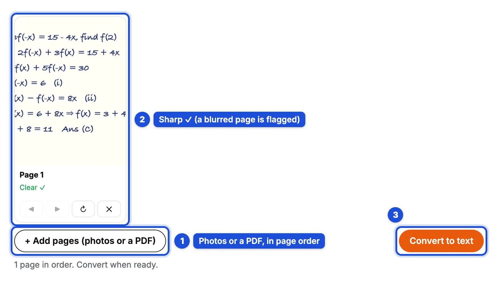

<!-- title: How to use srijitmath.com to build your excellence in mathematics?
subtitle: How to use the site, in five steps. Then pick up a pen.
published: 2026-11-13T13:08:45.108Z
updated: 2026-11-23T19:32:16.269Z -->

# How to use srijitmath.com to build your excellence in mathematics?

Mathematics grows only one way: you solve a problem yourself, with a pen, on paper. This website is built around that one habit. Here is all you need to know.

## 1. Pick a topic

Press **Start solving** and pick where you are:

- **School and Olympiad:** Algebra, Geometry, Combinatorics, Number Theory, Precalculus.
- **University:** Calculus I, Linear Algebra, Calculus II, Probability, Real Analysis, Abstract Algebra, Metric Spaces & Topology, Statistics.
- **Applied:** Programming, Quantitative Finance, Machine Learning.

Not sure? Start with Algebra. If it feels easy, move on. Every topic has short notes next to its problems. Read them when you need them, not before.

## 2. Solve on paper

Read the problem twice. Then close the laptop and solve it by hand. Give it at least 30 minutes before you open anything else.

## 3. Post your solution

Press **Solve**, take photos of your pages, and press **Convert to text**. The site types out exactly what you wrote. It does not fix or add anything. Check it, then post.

## 4. Read my grade, then discuss

I grade every solution out of 10 each night and write feedback only for you. If it asks you a question, answer it by editing your solution. Then press **Discuss**, read two other solutions, and reply to one.

## 5. Next problem, tomorrow

Go down the list on the left, one problem a day, in order. Your dashboard keeps every problem you have solved. Write to me in 💬 any time.

That's all. Paper first, website second. Disappear for one hour a day, and [start solving](https://srijitmath.com/start/).

