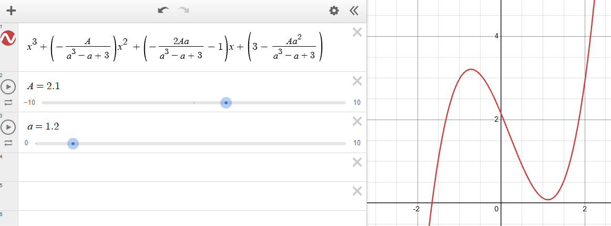

<!-- title: Is 2 the best constant?
subtitle: Regional Mathematical Olympiad 2026, Problem 3.
published: 2026-11-18T18:41:14.078Z
updated: 2026-11-18T18:42:57.477Z -->

# Is 2 the best constant?

## Problem

Prove that for any two real numbers $x$ and$y$, we have

$(x^6 - x^2 + 3)(y^6 - y^2 + 3) > 2(x^2 + y^2)^2.$

## Chain of thought

You can see that $x^6 - x^2 + 3$ looks reducible to a lower-degree polynomial. Let's assume $x^2 = a$ and $y^2 = b$. This also reduces the RHS of the expression. So you get

$(a^3 - a + 3)(b^3 - b + 3) > 2(a + b)^2.$

How do you do this now? Also, note that $a$ and $b$ are now non-negative real numbers.

Now you can see that the expression consists of a cubic polynomial on the LHS. Let's define the polynomial $p(x) = x^3 - x + 3$. So we are required to prove that $p(a)p(b) > 2(a + b)^2$, where both $a, b \ge 0$.

Both the expressions in the LHS and RHS are multivariate polynomials in $(a, b)$. But the LHS is multiplicative in nature, so it can be written as a multiplication of two univariate polynomials in $a$ and $b$. The RHS cannot be written in a multiplicative format. So my question was: can you show something like $p(x) > q(x)$ for all $x \ge 0$? Then we can show that $p(a)p(b) > q(a)q(b) > 2(a + b)^2$. This was the core idea.

But we cannot do this if $p(x)$ is not positive for $x \ge 0$. Let's check the sign of $p(x) = x^3 - x + 3$. For $x \ge 1$, $x^3 \ge x$, so $p(x) \ge 3$. What happens for $0 \le x \le 1$? $x^3 - x$ cannot go below $-1$, right? So $x^3 - x \ge -1$ gives $p(x) > 2$. Hence $p(x) > 0$. Now it becomes easier, as the inequality signs won't change.

More important is coming up with $q(a)q(b)$, and then the proof backwards. Let's think of an inequality that gives $(a + b)^2$ on the RHS, leaving the constant $2$ aside for a moment. What about Cauchy-Schwarz?

$(x_1^2 + \dots + x_n^2)(y_1^2 + \dots + y_n^2) \ge (x_1y_1 + \dots + x_ny_n)^2.$

So if we take $(a^2 + 1)(1 + b^2) \ge (a + b)^2$. This is cool, right? For the extra $2$, we can write

$(a^2 + 2)(2 + b^2) \ge 2(a + b)^2.$

So we have got $q(x) = x^2 + 2$. The next question therefore comes: is $p(x) \ge q(x)$ for all $x \ge 0$? This reduces to showing that $x^3 - x + 3 \ge x^2 + 2$. Let's write it coherently on the LHS: $x^3 - x^2 - x + 1 \ge 0$. This looks factorizable! Do you see the $(x - 1)$ factor? This is an opportunity. By factorization, you get

$x^3 - x^2 - x + 1 = (x - 1)(x^2 - 1) = (x - 1)^2(x + 1).$

This is beautiful. $(x - 1)^2 \ge 0$ and $x + 1 \ge 1$, so $p(x) \ge q(x)$. Hence

$p(a)p(b) \ge q(a)q(b) \ge 2(a + b)^2.$

## Is 2 the best constant?

But is $2$ the optimum factor, or are there other optimum factors? What if I ask: what is the maximum value of $A$ such that

$(x^6 - x^2 + 3)(y^6 - y^2 + 3) > A(x^2 + y^2)^2?$

Of course $A \ge 2$. Let's redo the steps. $q(x)$ will now be $x^2 + A$. Hence we ask if $p(x) > x^2 + A$ for all $x \ge 0$. This leads to the polynomial $x^3 - x^2 - x + (3 - A)$. So the question becomes: what is the largest $A$ possible? In other words, we want the maximum value of $A$ such that $m(x) = x^3 - x^2 - x \ge A - 3$. So $A - 3$ is the minimum value of $m(x)$ for $x \ge 0$.

Look at $m(x) = x^3 - x^2 - x = x(x^2 - x - 1)$. The discriminant of $x^2 - x - 1$ is $5 > 0$, hence all the roots are real: one positive, one zero, and one negative. You can visualize the graph by the wavy curve method. It comes up from $-\infty$, crosses zero at the negative root, shoots up, takes a maximum, comes down and meets $0$, pushes down for $x \ge 0$, takes a minimum, then goes up, crosses at the positive root, and goes to $+\infty$. We have to find that minimum on the positive $x$-axis.

We can use calculus (although there are non-calculus ways to do it). $m'(x) = 3x^2 - 2x - 1 = 0$ gives $(3x + 1)(x - 1) = 0$, so the minimum happens at $x = 1$. Plugging it in, $m(1) = -1$, so $A - 3 = -1$, and $A = 2$ is the maximum value possible this way.

In fact, we didn't need calculus:

$x^3 - x^2 - x + (3 - A) = (x - 1)^2(x + 1) + (2 - A).$

The curve $(x - 1)^2(x + 1)$ comes from $-\infty$, crosses the axis at $x = -1$, rises, comes down, and kisses the $x$-axis at $x = 1$. So if we take any $A > 2$, we bring the graph down, and at $x = 1$ it becomes negative.

But is that the whole story? If you look at the picture below, you will see that even at $A = 2.1$, the curve stays above $0$. So $2$ is not the largest possible $A$.

We now need more advanced machinery: $A \le \frac{p(x)p(a)}{(x + a)^2} = \frac{(x^3 - x + 3)(a^3 - a + 3)}{(x + a)^2}.$

We will use multivariate calculus on $g(x, a) = \dfrac{(x^3 - x + 3)(a^3 - a + 3)}{(x + a)^2}$ and find its minimum. By calculation, you will find that $A_{\max} \approx 2.1479$. I will leave the multivariate critical point calculation to you. The calculation is not hard at all: you will end up finding quadratic roots and plugging them back into $g(x, a)$ to get the maximum value of $A$.

